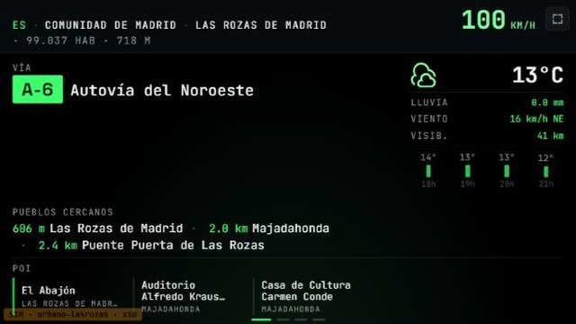
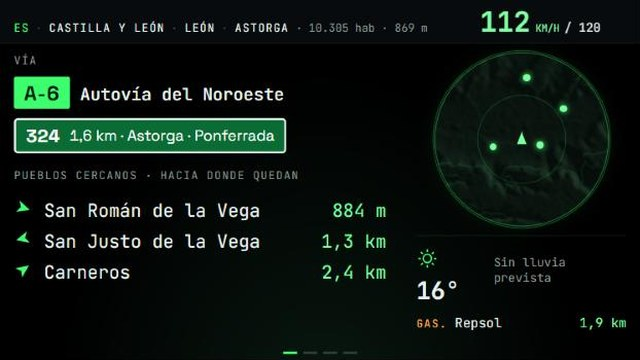
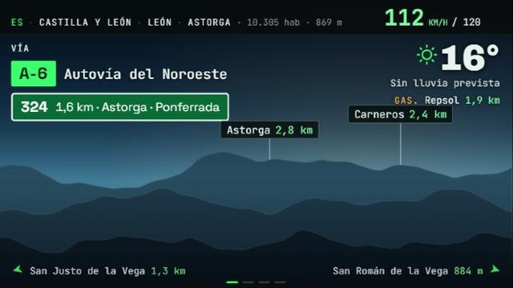
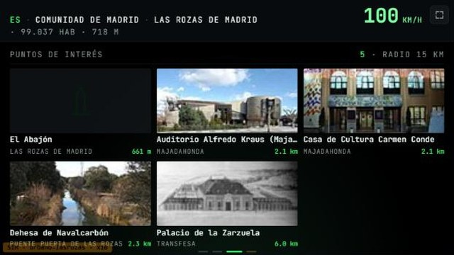
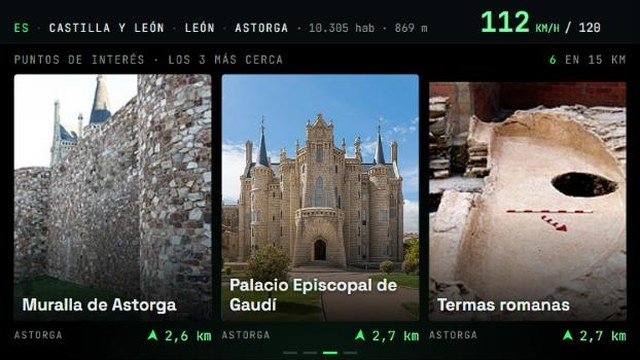
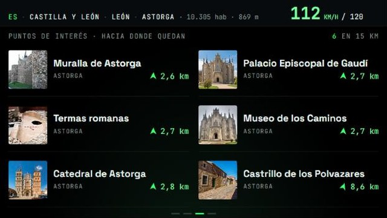

# Propuesta: las vistas 1 y 3 con el estilo nuevo

**Carpeta**: `specs/004-vistas-1-y-3/` · **Fecha**: 2026-10-18 · **Estado**: maquetas para que elijas.
Sin código todavía: hasta que digas cuál, las vistas siguen como están.

**De dónde sale**: en la lista de mejoras pequeñas iba "las vistas 1 y 3 con el estilo nuevo del
paisaje y el radar, con maquetas antes de código". Estas son las maquetas: dos opciones para cada
vista, con un caso real (la A-6 llegando a Astorga desde León, hacia el oeste) y el relieve y el
paisaje dibujados por el propio panel. Las imágenes están en `maquetas/` (y el HTML de cada una).

## Lo que tienen en común

- **Flechas de dirección.** Cada pueblo y cada sitio dice hacia dónde queda: la flecha hacia arriba
  es "de frente", hacia la derecha "a tu derecha", hacia abajo "detrás". Sale del rumbo que el
  panel ya calcula. Es lo que más ayuda a mirar por la ventanilla en el momento justo.
- **Menos cosas y más grandes.** La vista 1 deja la tira de puntos de interés (ya están en la
  vista 3) y el tiempo queda en una línea (el detalle está en la vista 2).
- **Lo que no cambia**: la cabecera, la vía con su pastilla, el cartel verde de la próxima salida,
  el modo noche, el gesto de marcar.

## Vista 1

Ahora:

### A · Cuadro de mandos

Los pueblos en una lista grande, cada uno con su flecha. A la derecha, un radar pequeño con el
relieve, girado hacia donde vas, y los pueblos como puntos. Debajo, el tiempo y la gasolinera.

### B · Paisaje

De fondo, el paisaje de la vista 2, quieto, con la luz de la hora y el tiempo que hace (en la
imagen, las 18:30). **Los pueblos de delante salen como carteles sobre el horizonte, en su
dirección de verdad**: Astorga casi de frente, Carneros delante a la derecha. Los que quedan
detrás, abajo en su esquina con su flecha. Es el primer paso hacia "el horizonte de verdad".

## Vista 3

Ahora:

### A · Postales

Los tres sitios más cercanos, con la foto grande y el nombre encima; debajo, el pueblo, la flecha
y la distancia.

### B · Lista con flechas

Los seis sitios en lista: foto pequeña, nombre grande, flecha y distancia.

## Lo que cuesta cada una

| | Datos | Móvil viejo |
|---|---|---|
| Vista 1 · A | El radar pequeño usa el relieve de la vista 4. **Si ese viaje no abres la vista 4, lo bajaría la vista 1**: lo mismo que el radar, ~1 MB por hora | Se dibuja al recomponer el relieve (cada ~1,5 km) |
| Vista 1 · B | Nada | El paisaje se pinta una vez y cambia con la hora y el tiempo; quieto, sin animación |
| Vista 3 · A | **Menos que ahora**: 3 fotos en vez de 6 | Nada nuevo |
| Vista 3 · B | **Mucho menos que ahora**: fotos pequeñas (~10 KB cada una en vez de ~40 KB) | Nada nuevo |

## Casos raros

- **Parado o sin rumbo** (al arrancar, en un semáforo largo): las flechas se quedan con el último
  rumbo conocido; si todavía no hay ninguno, no salen. En la B, los carteles se ponen en fila.
- **Varios pueblos en la misma dirección** (B): se escalonan en dos alturas; si aun así no caben,
  se queda el más cercano.
- **Pueblos de nombre largo**: se cortan con "…" antes que montarse unos sobre otros.
- **Sin foto** (vista 3): el icono del tipo de sitio, como ahora.
- **De noche**: como todo el panel, con el brillo bajo; en la B, además, el paisaje es el de la noche.

## Mi recomendación

- **Vista 1: B (Paisaje).** Es tu idea de chillout llevada a la vista principal, no gasta datos, y
  los carteles en su dirección real se entienden de un vistazo. La A es más "instrumento", pero
  repite el radar de la vista 4 y, si no la abres, gasta datos.
- **Vista 3: A (Postales).** Tres sitios bien grandes se leen conduciendo; seis pequeños, peor. Si
  prefieres ver más sitios a la vez, la B, que además ahorra datos.

## Preguntas para ti

1. Vista 1: ¿A, B o como está?
2. Vista 3: ¿A, B o como está?
3. Las flechas de dirección (salen en las dos), ¿te sirven?
